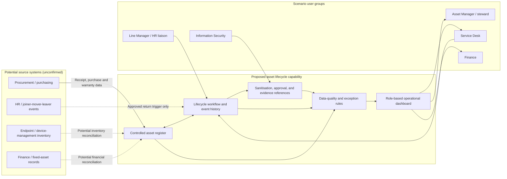

# Solution Context

> **Conceptual context only:** This diagram describes a proposed logical solution for the fictional scenario. It is not an architecture for a deployed or selected product.

## Context boundaries and design principles

- **System of record:** Not selected. Each source and attribute owner needs discovery and data profiling before integration design.
- **Data minimisation:** Prefer synthetic or internal references in routine reporting; protect any production employee data through role-based controls and retention policy.
- **Control separation:** The role that performs sanitisation should not automatically be assumed to be the independent approver; agree segregation of duties.
- **Auditability:** Model status transitions and evidence as timestamped events, not merely overwritten snapshot fields.
- **Resilience:** Define refresh/failure visibility and whether stale data blocks a decision; no operational service levels are claimed.
- **Prototype boundary:** Current dashboard is a static browser prototype over a local CSV. It has no integrations, authentication, backend, persistence, or production controls.

## Interfaces to discover

| Interface | Candidate data | Discovery decision |
|---|---|---|
| Procurement to asset register | purchase order/reference, receipt date, asset identifier, warranty | Authority, timing, matching and error handling |
| HR/JML to return workflow | approved leaver/mover event and effective date | Minimum data, consent/purpose, delivery channel, owner |
| Endpoint inventory to register | device identity, last seen, technical attributes | Source authority, reconciliation cadence, exception resolution |
| Asset register to finance | asset ID, in-service/disposal date, finance reference | Reconciliation population and variance management |
| Register/workflow to dashboard | governed, minimised reporting view | Refresh, filters, role access, metric definitions |
