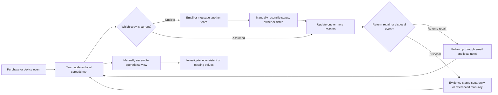
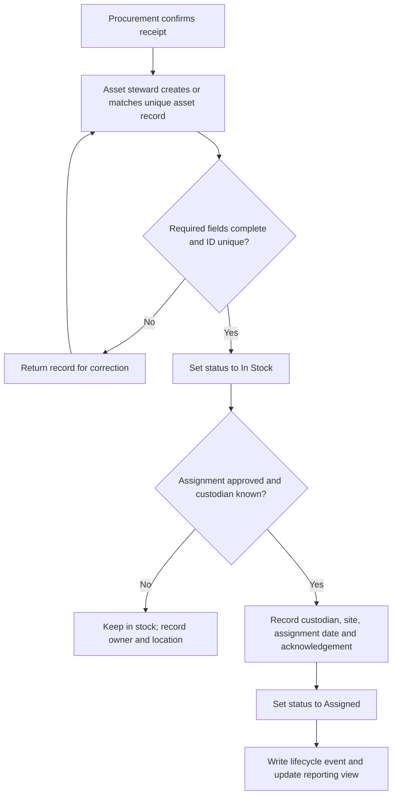
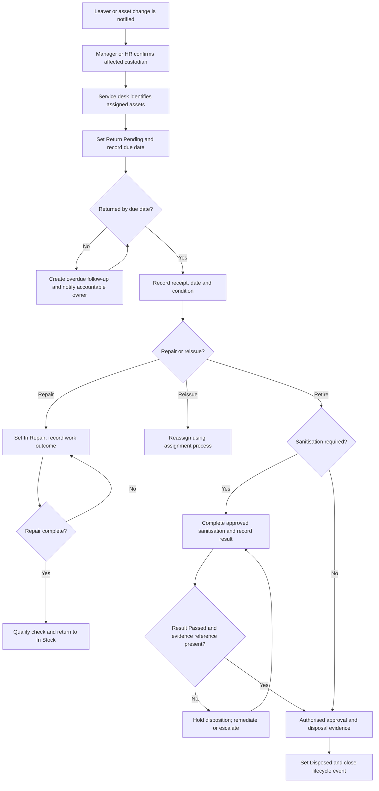
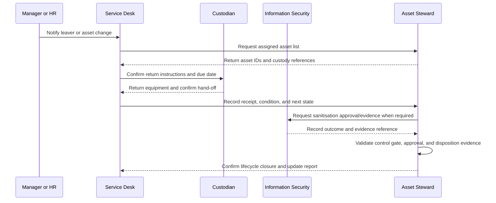

# Proposed Lifecycle Process Models

> **Model status:** These are proposed future-state models for a fictional portfolio scenario. They are not evidence of an implemented or approved workflow.

## 1. AS-IS (assumed scenario)

> **Validation needed:** No real current-state interviews or observations were performed. This model visualises the scenario hypothesis of disconnected records and informal hand-offs; replace it with validated evidence in a real engagement.

**Hypothesised friction points:** unclear source of truth, duplicate updates, reliance on individual follow-up, inconsistent definitions, and evidence references separated from lifecycle status. These are assumptions to validate, not confirmed process findings.

## 2. TO-BE: receive and assign an asset

**Control points:** Unique ID before assignment; required fields before a status change; custodian acknowledgement; auditable event with actor, timestamp, and reason.

## 3. TO-BE: return and disposition

**Control points:** Return due date and escalation owner; receipt and condition capture; sanitisation gate; separate approval/evidence before final disposition.

## 4. TO-BE role hand-offs (conceptual swimlane)

## State-transition guardrails

| From | To | Required information / guardrail |
|---|---|---|
| New record | In Stock | Unique ID, asset type, source, receipt date, site, and owner |
| In Stock | Assigned | Custodian reference, assignment date, site, and acknowledgement |
| Assigned | Return Pending | Return trigger, accountable owner, and due date |
| Return Pending | In Repair | Receipt date and condition |
| Return Pending | In Stock | Receipt, condition, and quality/reissue check |
| In Repair | In Stock | Repair outcome and quality check |
| In Stock / In Repair | Ready for Disposal | Retirement reason and sanitisation requirement decision |
| Ready for Disposal | Disposed | Required sanitisation Passed + evidence, approval, and disposal evidence |
| Any active state | Lost / Stolen | Incident reference, reporting owner, and investigation status |

The exact allowed transitions, approvals, and required attributes would be confirmed during implementation design. The sample CSV is a point-in-time snapshot and does not itself represent a validated transition history.

## Responsibility summary (RACI proposal)

`R` = Responsible, `A` = Accountable, `C` = Consulted, `I` = Informed.

| Activity | Asset Manager | Service Desk | Manager / HR | Custodian | InfoSec | Finance |
|---|---:|---:|---:|---:|---:|---:|
| Define lifecycle policy and statuses | A/R | C | C | I | C | C |
| Capture receipt and assignment | A | R | I | R | I | I |
| Initiate return and follow-up | A | R | R | R | I | I |
| Set sanitisation control | C | I | I | I | A/R | I |
| Approve and evidence disposal | A/R | C | I | I | C | C |
| Reconcile operational and financial views | R | C | I | I | I | A/R |

This is a discussion model, not an agreed governance or segregation-of-duties decision.
